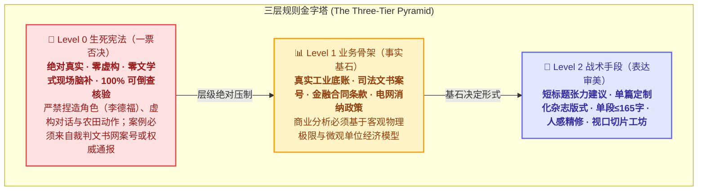
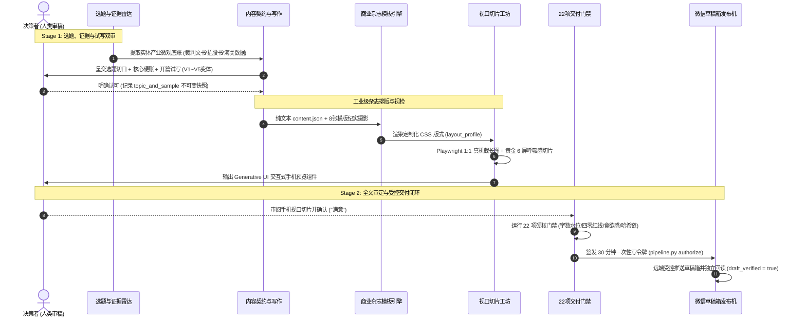

<div align="center">

# 📰 WeChat Editorial Engine (微信商业杂志级内容自动化引擎)

**对标《彭博商业周刊》《财新》排版水准 · 实体产业真实硬账基石 · 22 项工业级交付门禁 · 手机 1:1 视口切片工坊**

[](https://opensource.org/licenses/MIT)
[](#-核心架构与生产流水线)
[](https://www.python.org/)
[](https://playwright.dev/)
[](https://palletsprojects.com/p/jinja/)
[](#-三层规则金字塔生死红线不可颠倒)

<p align="center">
  <b>彻底终结“灰字长文裸奔”与“廉价 AI 模板感”，打造出版级公众号商业大刊</b>
</p>

</div>

---

## 🌟 为什么需要 WeChat Editorial Engine？

目前全网所谓的“AI 公众号全自动写作”，99% 都沦为了**粗制滥造的提示词流水线**：
* ❌ **虚假故事与假人设泛滥**：凭空捏造老农“李德福”或知乎体第一人称经历，一查全是编造；
* ❌ **晚会式空洞升华**：“在时代的大潮中稳步前行”，充斥废话与套话，单段动辄 400 字引发视觉疲劳；
* ❌ **模板千篇一律**：千篇一律的卡片拼接，缺乏商业大刊针对垂直产业独特的版式语言与调色盘；
* ❌ **配图缺乏食欲感与专业质感**：甚至选入带有油腻肉手、受潮发褐氧化粉末的买家秀差评图，毁掉文章信任。

**WeChat Editorial Engine** 是首个专为**严肃实体产业、深度财经与大众供应链硬账**打造的端到端商业杂志级内容工程。它以**Level 0 绝对真实**筑牢底线，通过**两阶段人机协同审批闭环**与**单篇定制化杂志模板引擎**，让每一篇交付物都具备《彭博商业周刊》式的出版级质感。

---

## 🏛️ 三层规则金字塔（生死红线不可颠倒）



> **层级压制铁律**：Level 2 永远只能在 Level 0 和 Level 1 筑牢的真实铁壁内施展，绝对不能反客为主！借口“增强代入感”编造人物姓名或生活场景者，**直接就地死刑推翻**。

---

## ⚙️ 核心架构与生产流水线



---

## 🎨 商业杂志级排版体系（拒绝廉价模板感）

母模板通过 `layout_profile` 机制实现**向后兼容与 100% 定制化排版自由**：

### 1. 独家微观账本组件库
* **首屏沉浸大图 (`lead_image`)**：正文前置宽幅实况摄影与引言金句卡，5 秒内建立强烈的产业场域；
* **单位经济双栏对比表 (`metrics`)**：如设施基质温室（10~15万/亩）vs 传统露地土壤（2~3万/亩）微观投资回报拆解；
* **价格断崖阶梯卡 (`price_cliff`)**：早春暖棚（120~160元/斤）至露地大汛（15~25元/斤）的价格落差标尺；
* **微观工艺极限 Callout (`callout`)**：压差预冷 2 小时强制降温至 0~2℃ 的冷链生死线；
* **纯净结语卡 (`closing_box`)**：以产业出清规律与微观常识收尾，**严禁晚会式口号升华**。

### 2. 配图“食欲感与专业质感一票否决红线”
超越常规四零红线（零 AI、零红章水印、零正面人脸、零图文错位），确立**最高级别质感红线**：

```text
🚫 绝对禁止（反面标靶）：
  - 严禁肉手手指捏持近景特写；
  - 严禁受潮发褐氧化粉末粘连在塑料缝隙（酷似污垢/变质残渣）；
  - 严禁毛刺塑料与地摊差评买家秀视角。

✅ 工业出版级规范（正向标杆）：
  - 食品果蔬优先选用自然晨光、晨露挂果与完整天然果粉白霜；
  - 现代工业优先选用不锈钢防尘产线、明亮工况与对称几何美学实拍。
```

### 3. 移动端表格车祸防爆四大铁律 (R12 核心)
针对手机端（360~390px 物理视口）阅读场景建立刚性防爆规范：
* **一禁 3 列及以上固定硬表格**：强塞正文必然导致单字跳行与数字折裂，必须降维为双列卡片（Dual-Pill Cards）或行式清单；
* **二禁数值与单位无保护裸奔**：凡涉及价格/指标强制包裹 `white-space: nowrap;`，字号上限 ≤16px 加粗，彻底消灭孤悬次行的单字母（如字母“`g`”）或单汉字；
* **三禁生硬 1px 黑细线与白底裸奔**：封装入独立圆角呼吸底色卡片（暖灰/雅蓝底色），4 项指标自动 2×2 网格呼吸排布；
* **HTML 字符数精细预算（10,500 字符红线）**：精炼内联 style，在确保 2,550~2,720 字出版级汉字与多图的同时，将 HTML 字符总数控制在 10,500 字以内。

### 4. 发后数据穿透诊断与静默发布避坑 (R12 核心)
* **避坑静默发布误杀**：微信订阅号发表时**必须点击【发表】并勾选“开启群发通知”**，严禁点击无通知“发布”（静默发布剥夺读者弹窗通知，导致冷启动样本不足一票误杀）；
* **深度数据穿透诊断引擎**：集成双列表穿透巡检脚本，一键提取真实 7 大渠道占比（公域算法推荐流 vs 私域社交）、完读率与送达率，台账日日连续沉淀。

---

## 🛠️ 快速上手 (Quick Start)

### 1. 环境准备
```bash
git clone https://github.com/No1Hoo/wechat-editorial-engine.git
cd wechat-editorial-engine

# 安装 Python 依赖
pip install -r requirements.txt

# 安装 Playwright 浏览器内核 (用于 1:1 视口切片)
playwright install chromium
```

### 2. 配置凭据
```bash
cp accounts.yaml.example accounts.yaml
cp .env.example .env
cp config/delivery_runtime.example.json config/delivery_runtime.json

# 编辑 accounts.yaml 填入您的微信公众号 AppID 与 AppSecret
```

### 3. 运行官方示范 Demo（蓝莓全产业链篇）
项目内置完整的蓝莓全产业链真实脱敏 Demo（`demo/2026-10-13-blueberry-price-chain`）：

```bash
# 1. 校验内容契约 (检查纯汉字 2550~2720 水位，单段 ≤ 165 字)
python pipeline.py check --dir demo/2026-10-13-blueberry-price-chain

# 2. 渲染商业杂志级 HTML
python pipeline.py render --dir demo/2026-10-13-blueberry-price-chain --track A

# 3. 生成 1:1 手机真机视口切片与 Generative UI 预览组件
python .agents/skills/wechat-magazine-preview/scripts/preview_slicer.py \
  --dir demo/2026-10-13-blueberry-price-chain \
  --output demo/2026-10-13-blueberry-price-chain/preview_widget.html

# 4. 执行 22 项严格交付门禁质检
python scripts/delivery_gate.py --dir demo/2026-10-13-blueberry-price-chain --stage prep
```

---

## 📚 沉淀文档与工业级避坑宝典

本项目沉淀了数十轮实战血泪教训，形成业内最详尽的生产避坑手册：
* 📖 [**WECHAT_CANONICAL_WORKFLOW.md**](docs/WECHAT_CANONICAL_WORKFLOW.md)：两阶段审批契约与现行统一交付流程；
* 📖 [**PRODUCTION_PITFALLS_AND_LESSONS.md**](docs/PRODUCTION_PITFALLS_AND_LESSONS.md)：**实战避坑与深度教训沉淀手册（二十八节全集）**：
  * *第二节*：配图历史索引覆盖查重陷阱；
  * *第六节*：跨平台换行符（UNIX LF）哈希指纹漂移；
  * *第十九节*：本地模板与发稿机云端部署环境一致性同步铁律（SCP 同步）；
  * *第二十六节*：存量资产审美重构与真机切片预览 SOP；
  * *第二十八节*：Track A 单数配图插槽 `sec.image`、HTML 10500 字符精细控制与现泡茶瓶盖反面标靶解剖。

---

## 🛡️ 安全与脱敏防护

本项目配备严格的自动化安全扫描器，防止凭据误提交：
```bash
# 执行本地预提交安全扫描
python scripts/security_audit.py
```

---

## 📄 开源许可证

本项目采用 [MIT 许可证](LICENSE)。欢迎实体产业观察者、数据新闻团队与独立自媒体开发者共同维护！
